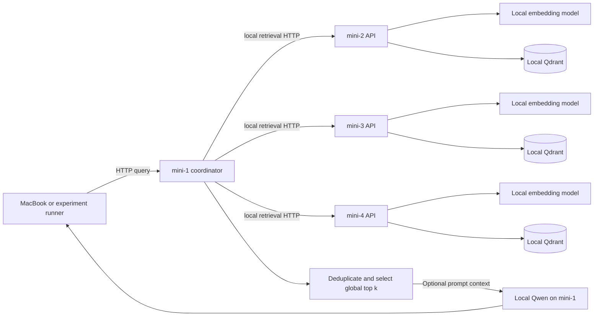
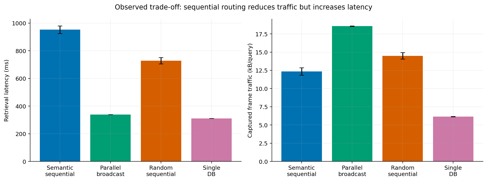

# Belleq Local

**A reproducible laboratory for distributed knowledge retrieval, network
measurement and empirical simulation.**

[](https://github.com/sstprk/belleq-local/actions/workflows/ci.yml)
[](LICENSE)

Belleq Local searches independent document collections over HTTP, combines the
retrieved passages and optionally asks a local Qwen model to answer from them.
The accompanying simulator estimates latency and captured traffic from recorded
experiments and exposes a simple English web interface.

This repository contains **both the real lab system and the simulator**. You can
try the simulator on one computer without Qdrant, Ollama, an account or access to
the lab. The lab service requires the separate setup described below.

**Research scope:** four M2 Mac minis with 8 GB RAM, one coordinator, three search
workers, 12 novels, 16,421 chunks and 500 shared synthetic questions. The main
comparison contains 2,000 real attempts at score threshold 0.70; two attempts
failed. This is application-level distributed retrieval, **not** native Qdrant
clustering, distributed LLM training, model sharding or federated learning.

## Start here

| Goal | Guide |
|---|---|
| Try the local web simulator | [Quick start below](#quick-start-the-simulator) and [simulator guide](simulator/README.md) |
| Install the four-computer lab | [Detailed Mac mini setup](docs/LAB_SETUP.md) |
| Upload books and run the policies | [Experiment protocol](docs/EXPERIMENTS.md) |
| Use the HTTP endpoints | [API catalog](docs/API.md) |
| Download the recorded research inputs | [Data and licenses](docs/DATA.md) |
| Rebuild models, figures and checks | [Reproducibility guide](docs/REPRODUCIBILITY.md) |
| Understand the results and limits | [Results](docs/RESULTS.md) |
| Run tests or contribute | [Testing](docs/TESTING.md) and [contribution guide](CONTRIBUTING.md) |
| Host the optional stateless demo | [Web demo guide](docs/WEB_DEMO.md) |

## Quick start the simulator

Use **Python 3.12**. Internet is needed once to install packages; inference then
works offline. Commands below are for macOS/Linux and run from a source checkout.

```bash
git clone https://github.com/sstprk/belleq-local.git
cd belleq-local
git checkout v0.2.0
cd simulator
python3.12 -m venv .venv
.venv/bin/python -m pip install -r requirements.lock
PYTHONPATH=src .venv/bin/python -m belleq_sim serve --port 8010
```

Open **http://127.0.0.1:8010**. Leave the terminal open and stop with **Ctrl+C**.
On macOS, subsequent starts can use `simulator/start.command`. In Windows use
`.venv\Scripts\python.exe`, set `PYTHONPATH=src`, and run the same module; this
release was not physically validated on Windows.

The default broadcast estimate is approximately **339 ms**, **18.6 kB/search**
and **3 search computers contacted**. These are modeled retrieval results, not
the HTTP response time of the demonstration site. Including AI-writing time
samples recorded durations; it does not call an LLM or generate a new answer.

The UI offers three evidence levels:

- **Measured settings / `empirical`:** joint resampling of real query-policy
  records at the native one-worker or three-worker configuration.
- **Recorded candidates / `trace`:** replay of the saved five candidates per
  worker with a different threshold or stopping rule. No new vector search.
- **Different setup / `assumption`:** explicit hypothetical worker-count and
  cost settings. Unseen scales, larger corpora, queues and saturation are not
  validated. This mode deliberately does not predict retrieval quality.

The full local UI records runs under `simulator/results/ui_runs/`; CSV and JSON
can also be downloaded. These records are labeled simulations, not experiments.

## Real lab architecture



Each worker computes the query embedding locally. All workers must use the same
embedding model digest, dimension, cosine metric, prefixes and chunking schema.
The service fingerprints this configuration and rejects incompatible indexes.
Worker requests always call `/v1/retrieve/local`, so a coordinator cannot recurse
through its own aggregate endpoint.

| Computer | Ethernet address | Role |
|---|---|---|
| MacBook | `192.168.50.10/24` | SSH management; not a measured search worker |
| mini-1 | `192.168.50.11/24` | Coordinator, router, merger and answer model |
| mini-2 | `192.168.50.12/24` | Independent retrieval API and Qdrant |
| mini-3 | `192.168.50.13/24` | Independent retrieval API and Qdrant |
| mini-4 | `192.168.50.14/24` | Independent retrieval API and Qdrant |

The switch has no internet uplink or DHCP server. Use manual addresses with mask
`255.255.255.0`; leave Ethernet router and DNS blank. Wi-Fi can provide internet
for installation and is disabled before measurements. You can use other private
addresses by editing all corresponding configs; archived capture tools default
to the addresses above.

## Search policies

| Policy | Behavior |
|---|---|
| `broadcast` | Query all configured workers concurrently and merge candidates. |
| `semantic_sequential` | Rank cached worker descriptions by embedding similarity, then visit in order. No extra generative model call is used for routing. |
| `random_sequential` | Visit a seeded random permutation without replacement. |
| Single database baseline | Store all canonical vectors on one worker; configure the coordinator with only that retrieval endpoint. |

Sequential policies stop after collecting `top_k` unique above-threshold chunks,
or after exhausting the workers. **Reaching the similarity target is not proof
of a correct answer.** The recorded random-order experiment retained categorical
placement; it did not randomly shard text chunks. Genuine random placement is a
separate, unmeasured extension.

## Lab installation overview

The full guide covers Ethernet, SSH, offline operation, persistence and recovery.
After those prerequisites, on **each** mini:

```bash
brew install python@3.12 uv colima docker docker-compose
colima start --cpu 2 --memory 2 --disk 20
git clone https://github.com/sstprk/belleq-local.git
cd belleq-local
git checkout v0.2.0
uv sync --frozen --no-dev --python /opt/homebrew/bin/python3.12
# Replace mini-2 with this computer's ID.
cp config/categorical/mini-2.json config/local.json
docker-compose up -d
ollama pull nomic-embed-text:latest
# Only mini-1 also needs: ollama pull qwen3:1.7b
.venv/bin/python -m belleq_lab
```

Install and start the native [Ollama macOS application](https://docs.ollama.com/macos)
before the `ollama` commands. Qdrant runs in a pinned ARM64-compatible container;
Ollama runs natively on the Mac. **Do not run the simulator environment in place
of the lab environment.** Both have separate dependencies.

```bash
curl --fail http://192.168.50.12:8000/health/ready
curl --fail http://192.168.50.11:8000/v1/retrieve/aggregate \
  -H 'Content-Type: application/json' \
  -d '{"query":"What does Holmes deduce?","mode":"broadcast","top_k":3,"per_node_k":5,"min_score":0.70}'
```

## Recorded results

| Policy | Complete / attempts | Mean retrieval ms | Captured kB/query | Reference Hit@3 |
|---|---:|---:|---:|---:|
| Semantic sequential | 498 / 500 | 952.4 | 12.35 | 40.8% |
| Parallel broadcast | 500 / 500 | 338.6 | 18.56 | 42.8% |
| Random sequential | 500 / 500 | 727.9 | 14.47 | 41.4% |
| Single database | 500 / 500 | 310.4 | 6.15 | 42.6% |

Latency uses completed requests; traffic and reference-hit denominators retain
all attempts. Captured traffic is coordinator Ethernet frame accounting for
worker HTTP traffic inside query windows, **not total physical Ethernet load**.
Reference labels are synthetic, nonexhaustive and not human reviewed; Hit@3 is
not generated-answer accuracy. Policy and session effects are partly confounded.



The simulator's held-out mean errors were within 4.0% for retrieval and 5.6% for
captured traffic in the tested configurations. Client-duration means were
underestimated by roughly 8.4–10.1%. Ridge did not outperform the per-method mean
for retrieval or traffic. New worker counts are assumption-based, not physically
validated scaling results. See the [full interpretation](docs/RESULTS.md).

## Research inputs and reproducibility

The normal clone includes source, tests, the frozen JSON model, summary tables,
derived permutations, figures and the paper report. The larger measurement
inputs are a separate **versioned release asset**, not Git blobs:

```bash
# From the repository root, using only the Python standard library:
python3.12 scripts/fetch_research_data.py
```

The fetcher checks the archive SHA-256, checks each of 89 research inputs and
rejects unsafe extraction paths or replacement of different existing data.
For an offline import, download the archive once and use `--archive FILE`.
[Data availability](docs/DATA.md) explains the 2,000 main attempts, 1,000 auxiliary
0.80 attempts, 500 questions, packet captures and provenance. Only personal
`source_csv` paths were shortened; numerical observations were retained.

```bash
cd simulator
PYTHONPATH=src .venv/bin/python -m belleq_sim train
PYTHONPATH=src .venv/bin/python scripts/figures.py
PYTHONPATH=src .venv/bin/python scripts/verify.py
```

Use a separate clone when rebuilding: training writes derived tables and model
files. [Reproducibility](docs/REPRODUCIBILITY.md) distinguishes regenerating the
analysis from rerunning physical hardware and describes optional PCAP auditing.

## Repository layout

```text
belleq_lab/             Real FastAPI lab service and retrieval backends
config/                Per-mini example configs and categorical experiment profile
scripts/               Lab lifecycle, ingestion, evaluation and publication tools
tests/                 Lab service and orchestration tests
simulator/             Model, local web UI, CLI, training, figures and research report
web-demo/              Optional self-contained stateless Vercel adapter
docs/                  Setup, API, experiments, data, results and reproducibility
provenance/            Imported-file hashes and publication validation
data-release.json      Versioned research archive URL, size and SHA-256
CITATION.cff           Software citation metadata
```

## Citation license and journal use

Use the **v0.2.0 release and its exact commit**, rather than a moving `main`
branch, in an article's code-availability statement. GitHub exposes the metadata
in [CITATION.cff](CITATION.cff). The report and all five PNG/PDF figures are in
[the research report directory](simulator/paper_report_20261022/README.txt).

No journal acceptance, paper DOI or archival DOI is claimed. For a durable DOI,
archive the release with a suitable repository such as Zenodo, verify the author
list, then add the assigned DOI to the citation metadata. GitHub release URLs
identify a version but are not DOI registrations.

The software is [MIT licensed](LICENSE), with Belleq origin documented in
[PROVENANCE.md](PROVENANCE.md). Models, external libraries, original novels and
third-party materials retain their own terms; see [data and licenses](docs/DATA.md).
Read [security](SECURITY.md) before exposing a lab endpoint outside its isolated LAN.
