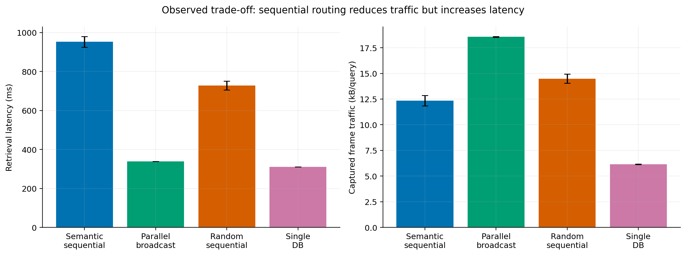

# Recorded findings and limits

The dataset is 500 shared synthetic questions × four policies at threshold .70:
2,000 real attempts, of which 1,998 completed. The corpus contains 12 novels and
16,421 chunks. These are repeated questions across methods, not independent
hardware configurations. Random sequential changes visit order on categorical
placement. The .80 auxiliary runs are stored separately.

| Policy | Retrieval mean ms | Retrieval p95 ms | Captured kB/attempt | Mean client seconds | Reference Hit@3 |
|---|---:|---:|---:|---:|---:|
| Semantic sequential | 952.4 | 1301.7 | 12.35 | 2.91 | 40.8% |
| Parallel broadcast | 338.6 | 345.6 | 18.56 | 2.31 | 42.8% |
| Random sequential | 727.9 | 945.9 | 14.47 | 2.59 | 41.4% |
| Single database | 310.4 | 316.1 | 6.15 | 2.23 | 42.6% |

Timing uses complete requests; traffic and hit denominators include all attempts.
Semantic routing transferred 33.5% fewer captured bytes than broadcast, but was
2.81× slower for retrieval. It averaged about 1.98 visited workers; the local
router itself averaged 291.2 ms. Fewer calls did not offset embedding/routing and
sequential waiting. Random sequential used 22.0% less traffic than broadcast but
was 2.15× slower. Consolidation was cheapest and fastest at this small corpus size.
These are cross-session observations, not universal causal performance claims.

## Simulator validation

The deployed model excludes the final 100 questions and every derivative of them.
On those questions, Monte Carlo mean retrieval errors ranged from −3.99% to +.19%
and mean traffic errors from −5.53% to +.15%. End-to-end means were underestimated
by 8.40–10.06%. These are distribution-level errors, not individual-query accuracy.

| Target | Selected point predictor | Test mean-baseline MAE | Test Ridge MAE | Selected pooled R² |
|---|---|---:|---:|---:|
| Retrieval ms | Method mean | 132.88 | 141.71 | .665 |
| Captured bytes | Method mean | 2567.26 | 2693.64 | .589 |
| Client ms | Ridge | 801.29 | 793.51 | .025 |

Within-policy R² values are negative; pooled values largely reflect differences
between methods. Question-length features do not yield a strong within-policy
predictor. The unsuccessful regression comparisons are retained rather than
selectively reporting a favorable model.

## Threshold and scale

The 0.0–1.0 threshold figure replays recorded top-five candidates from 400
calibration questions. At .8, reference hits are about 4.2% and nearly all workers
are visited; at .9 and 1.0 no marked references survive. Low thresholds allow early
acceptance of off-reference content. The two measured .80 auxiliary runs each had
23/500 reference hits and 470 no-context requests; they were not completely misses.

The virtual-worker figure assumes one source owner plus distractor profiles and
a semantic owner-first probability of .57. It does not redistribute the original
corpus or learn independent worker-count effects. A flat modeled broadcast latency
curve follows an uncongested max-service-time assumption; it is not evidence of
unlimited real scaling. No quality prediction is given for unseen worker counts.

## Interpretation boundaries

- Captured frame bytes are scoped coordinator-worker traffic, not total physical
  Ethernet load. Window Mbps is not link capacity or saturation throughput.
- Concurrency was one, with one measured attempt per question/policy and no
  independent repeated sessions per method. Method and session are confounded.
- Bootstrap intervals express question-sampling uncertainty only.
- Labels are synthetic, unreviewed and nonexhaustive. Reference Hit@3 is not
  generated-answer accuracy; the report includes examples showing the distinction.
- Replay matches all 1,998 successful saved outputs, but this verifies algorithm
  behavior rather than new-system prediction. Derived permutations are not trials.
- New corpus sizes, hardware, load, queues, WANs and random chunk placement need
  physical measurements. Independent randomized sessions and reviewed labels are
  the next priority, not simply more resamples of this same workload.

Machine-readable values are in `simulator/results/`; the report and complete
figure PDFs are linked from [the repository README](../README.md).
